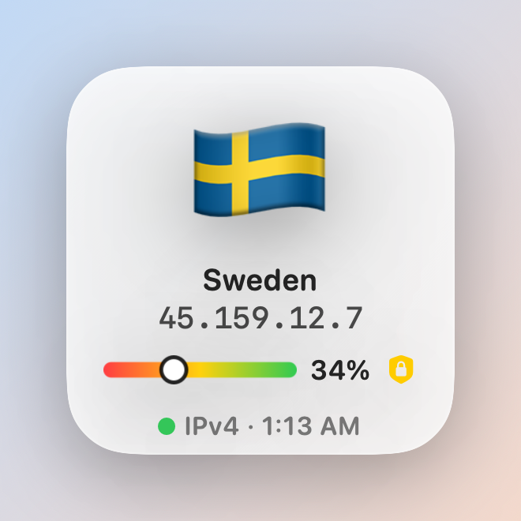
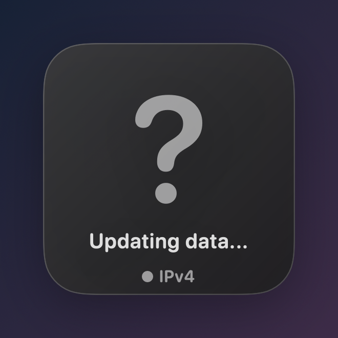

# IP Widget for macOS

A native macOS desktop widget showing your public IPv4 address, country name, flag, and IP reputation rating, with a lightweight menu bar companion.

**IP Widget reacts immediately to changes in the system's network configuration and requests fresh data automatically.** Switching Wi-Fi, Ethernet, or VPN connections, changing the default route, or reconnecting a network triggers a widget refresh without waiting for the periodic check. Keep the companion app running for event-driven updates; macOS WidgetKit controls the final rendering schedule.

<p align="center">
  
  
  
</p>

## Features

- Native small WidgetKit widget with a large flag, localized country name, and public IPv4 address.
- One shared result: only the companion queries IP services; the widget reads a local JSON snapshot.
- Data older than five minutes prompts you to open IP Widget. Clicking the widget launches or refreshes the companion.
- Immediate response to system network and default-route changes through `NWPathMonitor` and `SCDynamicStore`, including Wi-Fi, Ethernet, and VPN switches.
- Automatic checks approximately every four minutes, refresh after wake, and manual refresh from the menu bar.
- Choose 2ip.io or icanhazip.com as the preferred IP service in the app menu; the other is a fallback, with separate cooldowns after failures.
- Synthetic IP reputation rating with a red/yellow/green scale and VPN/proxy indicator; successful results are cached for 24 hours per IP.
- Bundled local country lookup database with automatic monthly updates by the companion app.
- Clear offline and service-unavailable states, light/dark appearance, and dimmed flag rendering.
- Optional launch at login; English and Russian interface localization.

## Requirements

- macOS 26 or later.
- Apple Silicon Mac (`arm64` build).
- For source builds: Swift 6 or later and Apple Command Line Tools or Xcode. The widget build defaults to the macOS 26.5 SDK; use `SDK` to select another installed compatible SDK.

## Download and install

1. Download the `.pkg` installer from [Releases](https://github.com/realspinner/MacOS_IP_Widget/releases/latest).
2. Open the installer and install the app into `/Applications`.
3. Open **IPWidget** from Applications. Its controls appear in the menu bar.
4. Right-click the desktop, choose **Edit Widgets**, search for **IP Widget**, and add the small widget.
5. Enable **Launch at Login** in the app menu if you want automatic network-change monitoring after login.

The current build uses ad-hoc code signatures. The installer is unsigned and is not notarized. macOS may block installation or execution on another Mac, and WidgetKit registration may require rebuilding locally. A Developer ID-signed and notarized distribution is needed for normal third-party installation.

To uninstall, quit the menu bar app, remove the desktop widget, and delete `/Applications/IPWidget.app`.

## Build and test

```bash
git clone https://github.com/realspinner/MacOS_IP_Widget.git
cd MacOS_IP_Widget
swift build
./scripts/test.sh
swift run IPWidgetSnapshot
./scripts/make-installer.sh
```

The snapshot tool writes preview PNGs to `build/snapshots/`. The installer script builds the app and embedded WidgetKit extension, verifies their ad-hoc signatures, and produces `dist/IPWidget-1.1.0.pkg`.

To build only the app, run `./scripts/build-app.sh`. To select an SDK or version:

```bash
SDK="$(xcrun --sdk macosx --show-sdk-path)" VERSION=1.1.0 BUILD_NUMBER=32 ./scripts/make-installer.sh
```

No third-party Swift packages, CocoaPods, or Homebrew dependencies are required. Build artifacts, caches, and installers are excluded from Git; installers belong in Releases.

On Command Line Tools 6.4, if Swift Testing reports that `TestingMacros` cannot be found, use the native build-system workaround documented in [Contributing](CONTRIBUTING.md).

## Preferred IP service

Open the menu bar app and choose **Preferred IP service → 2ip.io** or **icanhazip.com**. The default is 2ip.io; your choice is saved across launches.

Every check starts with the preferred service. A successful response ends the check. If that service fails, returns an invalid address, or is on cooldown, the app tries the other service once. There is no random rotation. A logical check therefore makes one request normally, or at most two sequential IP requests when fallback is needed.

Cooldowns and HTTP 429 `Retry-After` deadlines are separate for each service. Changing priority cancels the old check and starts the usual three-second settling sequence. With split VPN routing, different services may observe different exit addresses; priority controls the first service used, and fallback can return the other route's address. See [IP providers and country data](docs/ip-providers.md).

## IP reputation rating

After a successful IP check and completion of network stabilization, the companion requests reputation data from ProxyCheck v2. It computes an explainable index from the provider's risk and hosting/VPN/proxy/Tor/compromised classifications. A gradient scale, percentage, and yellow shield for VPN/proxy/Tor appear below the IP address; the menu bar app shows the same result.

**This is a heuristic reputation index, not a probability of access to Claude or another service.** A high value does not guarantee access. While data is unavailable, the widget displays `rating check...`; a failed lookup does not become a fabricated 0% or change the connection state.

Successful ratings are cached per IPv4 address for 24 hours and survive app restarts. The cache contains at most 64 entries at `~/Library/Caches/dev.spinner.ipwidget/ip-ratings.json`. The widget only reads the shared rating and sends no reputation requests. See [IP rating: calculation, cache, and limits](docs/ip-rating.md).

## How updates work

The menu bar app monitors network paths and system dynamic-store notifications for IPv4/IPv6 configuration changes. A network event immediately publishes a question mark and “Updating data...” to the widget. After three seconds without a newer event, the app performs one logical IP check (preferred service, then fallback only if needed). A newer event cancels the pending check and restarts the delay. Transition checks have no automatic retries; existing server rate limits are respected. Normal checks run roughly every four minutes; a one-minute route fingerprint check is a fallback for missed notifications.

Only the companion queries `https://api.2ip.io/` and `https://ipv4.icanhazip.com/`, in the selected priority order. It atomically writes the checked time, status, IP/country data, last successful update time, interface, and optional rating to `~/Library/Application Support/IPWidget/widget-state.json`. The directory is private to the user and the snapshot has mode `0600`. The extension has a read-only sandbox exception for that single file, has no network entitlement, and performs no IP, rating, or database requests. This supports the current ad-hoc distribution without App Groups.

The widget reads the shared result and schedules an **Open IP Widget** entry for when its check time becomes older than five minutes. Missing, corrupt, unsupported, or invalid data shows the same prompt. Clicking the widget opens `ipwidget://refresh` to launch or refresh the companion. If the app is closed, the widget makes no external requests. WidgetKit still controls when new timeline requests are rendered.

When the IP service does not return a country, the app uses its local DB-IP Country Lite database. See [IP providers and country data](docs/ip-providers.md) and the [resource audit](docs/resource-audit.md).

## Privacy and country data

IP checks by the companion contact the preferred service (2ip.io or icanhazip.com) and may contact the other on failure. These services necessarily receive your public IP address. Reputation checks contact ProxyCheck after a successful IP query, with successful ratings cached for 24 hours. Country database updates contact DB-IP over HTTPS. No API key or account is required. The app uses a local cache under `~/Library/Application Support/IPWidget/GeoIP/` for country database updates.

Country information describes the public exit address, including a VPN exit, rather than your physical location. IPv6-only address display is not supported.

Bundled country data: [IP Geolocation by DB-IP](https://db-ip.com), DB-IP Country Lite, November 2026, licensed under [CC BY 4.0](https://creativecommons.org/licenses/by/4.0/). The data is modified into a compact IPv4-only binary table. See [GeoIP-NOTICE.txt](Sources/IPWidgetCore/Resources/GeoIP-NOTICE.txt).

## Project layout

| Path | Purpose |
| --- | --- |
| `Sources/IPWidgetCore` | IP providers, country lookup, reputation calculation/cache, shared snapshot, and connection state |
| `Sources/IPWidgetUI` | Shared SwiftUI card, flags, and localization |
| `Sources/IPWidgetApp` | Menu bar app, route monitoring, login item, and widget registration |
| `Sources/IPWidgetWidget` | WidgetKit extension, compiled by the build script |
| `Sources/IPWidgetSnapshot` | Offscreen widget previews |
| `Tests/IPWidgetCoreTests` | Swift Testing suites for core behavior |
| `Resources` | App metadata, entitlements, localized strings, and flag assets |
| `scripts` | Build, test, icon generation, and installer scripts |

## Troubleshooting

If the widget is missing from the gallery, launch the installed app once and reopen Edit Widgets. To explicitly enable the extension:

```bash
pluginkit -e use -i dev.spinner.ipwidget.widget
```

If macOS keeps an old widget appearance after an update, restarting Notification Center can clear its cached view (`killall NotificationCenter`). Use **Refresh Now** from the menu bar if data appears stale. If launch at login needs approval, open **System Settings → General → Login Items**.

If the widget shows **Open IP Widget**, its snapshot is missing or older than five minutes; click it to launch or refresh the companion. If the connection is valid but `rating check...` remains visible, the reputation service may be unavailable or rate limited. Successful ratings can be up to 24 hours old; changing the preferred IP service does not force a new rating for an already cached IP.

For diagnostic logs:

```bash
log stream --level debug --predicate 'subsystem == "dev.spinner.ipwidget"'
pluginkit -m -v -p com.apple.widgetkit-extension
```

Report reproducible problems using [GitHub Issues](https://github.com/realspinner/MacOS_IP_Widget/issues), including your macOS version, installation method, network transition involved, and relevant logs with personal addresses removed.

## License

Project source code and documentation are licensed under the [MIT License](LICENSE).
Bundled DB-IP Country Lite data retains its separate [CC BY 4.0 attribution and license](Sources/IPWidgetCore/Resources/GeoIP-NOTICE.txt).
