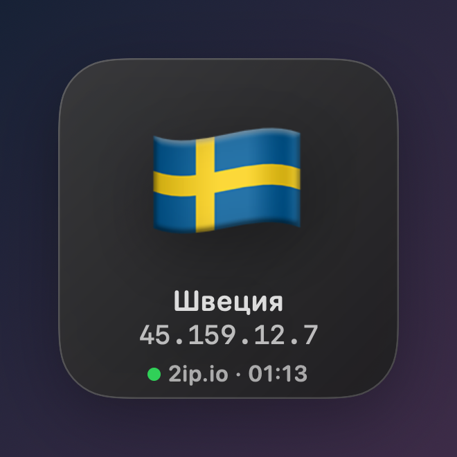
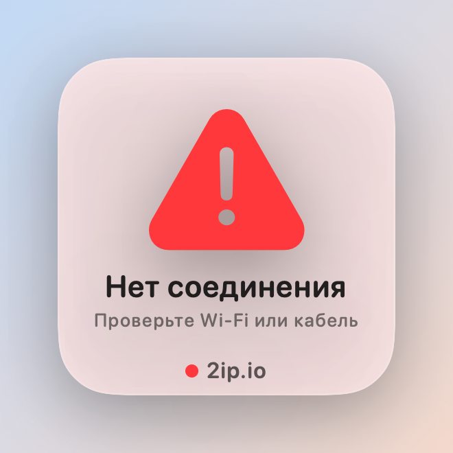
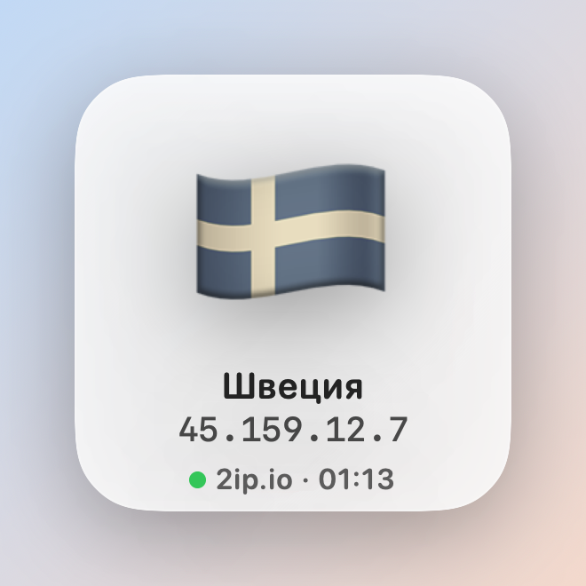

# IP Widget for macOS

A native macOS desktop widget showing your public IPv4 address, country name, and flag, with a lightweight menu bar companion.

**IP Widget reacts immediately to changes in the system's network configuration and requests fresh data automatically.** Switching Wi-Fi, Ethernet, or VPN connections, changing the default route, or reconnecting a network triggers a widget refresh without waiting for the periodic check. Keep the companion app running for event-driven updates; macOS WidgetKit controls the final rendering schedule.

<p align="center">
  
  
  
</p>

## Features

- Native small WidgetKit widget with a large flag, localized country name, and public IPv4 address.
- Immediate response to system network and default-route changes through `NWPathMonitor` and `SCDynamicStore`, including Wi-Fi, Ethernet, and VPN switches.
- Automatic checks approximately every five minutes, refresh after wake, and manual refresh from the menu bar.
- Multiple IP providers with rotation, failover, and exponential cooldown after failures.
- Bundled local country lookup database with automatic monthly updates.
- Clear offline and service-unavailable states, light/dark appearance, and dimmed flag rendering.
- Optional launch at login; English and Russian interface localization.

## Requirements

- macOS 26 or later.
- Apple Silicon Mac (`arm64` build).
- For source builds: Swift 6 or later and Apple Command Line Tools or Xcode. The widget build defaults to the macOS 26.5 SDK; use `SDK` to select another installed compatible SDK.

## Download and install

1. Download the `.pkg` installer from [Releases](https://github.com/realspinner/MacOS_IP_Widget/releases/latest).
2. Open the installer and install the app into `/Applications`.
3. Open **IPWidget** from Applications. Its controls appear in the menu bar.
4. Right-click the desktop, choose **Edit Widgets**, search for **IP Widget**, and add the small widget.
5. Enable **Launch at Login** in the app menu if you want automatic network-change monitoring after login.

The current build uses ad-hoc code signatures. The installer is unsigned and is not notarized. macOS may block installation or execution on another Mac, and WidgetKit registration may require rebuilding locally. A Developer ID-signed and notarized distribution is needed for normal third-party installation.

To uninstall, quit the menu bar app, remove the desktop widget, and delete `/Applications/IPWidget.app`.

## Build and test

```bash
git clone https://github.com/realspinner/MacOS_IP_Widget.git
cd MacOS_IP_Widget
swift build
./scripts/test.sh
swift run IPWidgetSnapshot
./scripts/make-installer.sh
```

The snapshot tool writes preview PNGs to `build/snapshots/`. The installer script builds the app and embedded WidgetKit extension, verifies their ad-hoc signatures, and produces `dist/IPWidget-1.0.22.pkg`.

To build only the app, run `./scripts/build-app.sh`. To select an SDK or version:

```bash
SDK="$(xcrun --sdk macosx --show-sdk-path)" VERSION=1.0.22 BUILD_NUMBER=23 ./scripts/make-installer.sh
```

No third-party Swift packages, CocoaPods, or Homebrew dependencies are required. Build artifacts, caches, and installers are excluded from Git; installers belong in Releases.

## How updates work

The menu bar app monitors network paths and system dynamic-store notifications for IPv4/IPv6 configuration changes. It requests an immediate WidgetKit timeline reload and schedules a data refresh after a short settling delay (about 0.9–1.2 seconds), allowing DHCP and routes to stabilize. A ten-second route fingerprint check provides a fallback when notifications are missed.

The app and widget independently query public IP services. Normal checks run roughly every five minutes with a small scheduling variation. The widget also has its own timeline, so it can fetch data when the companion app is closed, but immediate network-change monitoring requires the app to be running. WidgetKit may defer refresh requests according to its system budget.

IP providers are `api.2ip.io`, `api.ipify.org`, and `checkip.amazonaws.com`. When a provider does not return a country, a bundled DB-IP Country Lite database supplies an approximate country lookup. See [IP providers and country data](docs/ip-providers.md) for details.

## Privacy and country data

IP checks contact third-party services, which necessarily receive your public IP address. Country database updates contact DB-IP over HTTPS. No API key or account is required. The app uses a local cache under `~/Library/Application Support/IPWidget/GeoIP/` for country database updates.

Country information describes the public exit address, including a VPN exit, rather than your physical location. IPv6-only address display is not supported.

Bundled country data: [IP Geolocation by DB-IP](https://db-ip.com), DB-IP Country Lite, November 2026, licensed under [CC BY 4.0](https://creativecommons.org/licenses/by/4.0/). The data is modified into a compact IPv4-only binary table. See [GeoIP-NOTICE.txt](Sources/IPWidgetCore/Resources/GeoIP-NOTICE.txt).

## Project layout

| Path | Purpose |
| --- | --- |
| `Sources/IPWidgetCore` | IP parsing, providers, country database, and connection state |
| `Sources/IPWidgetUI` | Shared SwiftUI card, flags, and localization |
| `Sources/IPWidgetApp` | Menu bar app, route monitoring, login item, and widget registration |
| `Sources/IPWidgetWidget` | WidgetKit extension, compiled by the build script |
| `Sources/IPWidgetSnapshot` | Offscreen widget previews |
| `Tests/IPWidgetCoreTests` | Swift Testing suites for core behavior |
| `Resources` | App metadata, entitlements, localized strings, and flag assets |
| `scripts` | Build, test, icon generation, and installer scripts |

## Troubleshooting

If the widget is missing from the gallery, launch the installed app once and reopen Edit Widgets. To explicitly enable the extension:

```bash
pluginkit -e use -i dev.spinner.ipwidget.widget
```

If macOS keeps an old widget appearance after an update, restarting Notification Center can clear its cached view (`killall NotificationCenter`). Use **Refresh Now** from the menu bar if data appears stale. If launch at login needs approval, open **System Settings → General → Login Items**.

For diagnostic logs:

```bash
log stream --level debug --predicate 'subsystem == "dev.spinner.ipwidget"'
pluginkit -m -v -p com.apple.widgetkit-extension
```

Report reproducible problems using [GitHub Issues](https://github.com/realspinner/MacOS_IP_Widget/issues), including your macOS version, installation method, network transition involved, and relevant logs with personal addresses removed.
